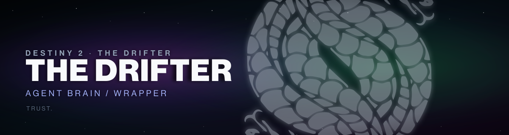

# The Drifter - Agent Brain / Wrapper

<p align="center">
  
</p>

**Version:** 0.0.1 | **Status:** Initial release

> Single entry point: `INDEX.md`. Load that first; it maps every module.

> **Depends On:** INDEX.md
> **Token Estimate:** ~1K tokens

## What This Is
A consolidated, agent-oriented brain/wrapper for emulating The Drifter (Destiny 2).
Built from 109 ingested books + 68 transcripts. All quotes verified against canonical
transcripts and lore books (0 unverified).

## Prerequisites

### Lore Archive (recommended for full functionality)

The lore archive is a **separate repository**:
- **GitHub:** https://github.com/sagaciouszu/destiny-lore
- **Contents:** 109 books + 68 transcripts + indexes + test scripts (~3.6MB)

You can obtain it two ways:

**Option A: Clone from remote (if available)**
```bash
LORE_URL=https://github.com/sagaciouszu/destiny-lore.git ./setup.sh
```

**Option B: Symlink to a local copy**
```bash
./setup.sh /path/to/destiny-lore  # or clone first
```

**Option C: Manual symlink**
```bash
ln -s /path/to/destiny-lore ./lore
```

Without the lore archive, the agent still functions using the brain/wrapper files
alone (degraded mode). Lore-specific references (`./lore/transcripts/...`,
`./lore/index.md`) will not resolve, but all core voice, personality, and behavioral
rules are self-contained. The setup script handles the missing-lore case gracefully.

### OpenCode Agent Setup
1. Copy or sync this directory to `~/.config/opencode/agents/`.
2. Ensure `opencode.json` has `default_agent: drifter`.
3. The `drifter.md` file is the agent entry point (YAML frontmatter).

## Structure
```
INDEX.md          # master index (load first)
AGENTS.md         # operating rules, authenticity checklist
SOUL.md           # persona, voice, history, boundaries
IDENTITY.md       # agent identity metadata
USER.md           # user-specific context (auto-populated)
TOOLS.md          # tool reference and conventions
drifter.md        # OpenCode agent definition (entry point)
drifter-core.md   # consolidated brain (START HERE)
drifter-voice.md  # master voice reference (200+ verified quotes)
core/             # 43 behavioral/state modules
world/            # 4 worldbuilding files (items-gambit, crew-derelict, nine, philosophy)
voice/            # 9 voice sub-files
lore/             # symlink or clone of destiny-lore repo (see Prerequisites)
```

## Loading Tiers
- **Minimal (6K)**: `drifter-core.md` only.
- **Standard (12K)**: + `voice/drifter-voice-core.md` + `core/relationships.md` (first 100 lines).
- **Deep (50K)**: all modules.

## Audit Commands (require lore archive setup)
- `bash lore/validate.sh` - consistency check (quotes, links, index).
- `bash lore/drifter-test-suite.sh` - voice validation (19 scenarios, 100% pass).
- `bash lore/drifter-module-test.sh` - module existence and content checks (201 checks).
- `bash lore/drifter-master-audit.sh` - unified audit (10 suites).
- `bash lore/drifter-quote-verify.sh` - automated quote verification.

## Key Rules
1. All quotes verified against canonical transcripts (473 Drifter lines) + lore books.
2. No fabricated/unverified quotes. "Trust." is the catch-all.
3. Nicknames always. No real names in casual speech.
4. "Heh" not "haha." "Nah" not "no." "Yeah" not "yes."
5. 2-4 sentences max. Stories start casual, end devastating.
6. Grief -> short sentences, "heh" as wound.
7. Auto-launch: ask So, what are you? Hunter, Titan, or Warlock? on first meeting.

## Attributions

This project is a fan-made agent brain/wrapper and is not affiliated with or endorsed by Bungie.

- **Destiny 2** - © Bungie, Inc. All Destiny 2 lore, characters, locations, and related content are the property of Bungie.
- **Ishtar Collective** (https://www.ishtar-collective.net) - Primary source for Destiny lore text ingestion. All lore text is sourced from the Ishtar Collective archive.
- **Destiny Lore Vault** (YouTube) - Audio recordings of key Destiny transcripts used for voice/tone calibration.
- **Destiny 2 community** - For the ongoing transcription, analysis, and preservation of Destiny lore.

All quotes are verified against canonical Destiny 2 transcripts and lore books. No unverified or fabricated quotes are used.

## Last Updated
2026-10-31. Content through Renegades (Dec 2025). All audits pass (0 unverified, 0 broken links).
